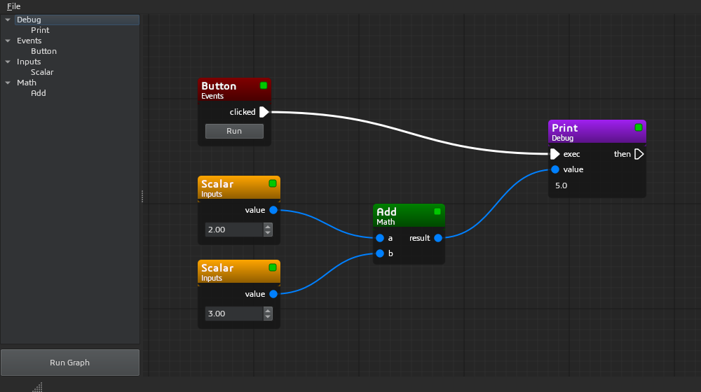
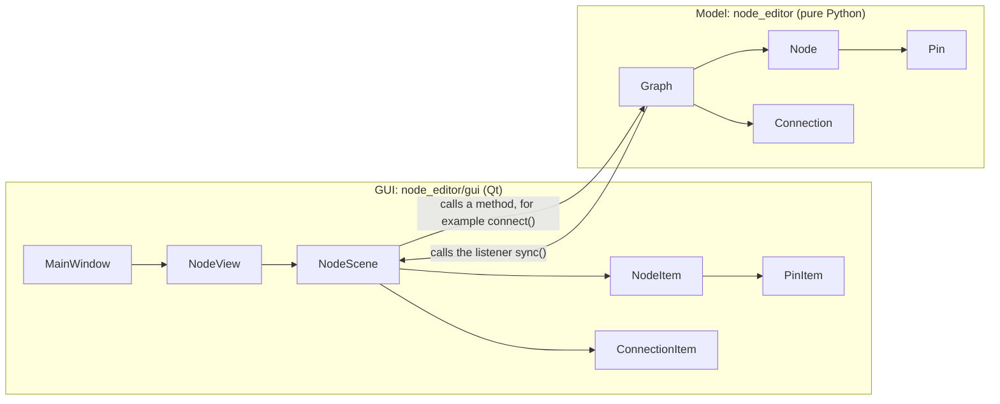

# Python Node Editor

[](https://github.com/bhowiebkr/python-node-editor/actions/workflows/ci.yml)

A small node editor in Python and PySide6, made to be easy to read and learn from.

The full editor is about 1,500 lines of Python, with comments. Read the code to learn how a node editor works: nodes, pins, connections, run order, save and open.



> For a larger editor that keeps the Python code inside the nodes, see [PyFlowCanvas](https://github.com/bhowiebkr/PyFlowCanvas/).

## Quick start

You need Python 3.10 or newer.

Windows:

```bat
git clone https://github.com/bhowiebkr/python-node-editor.git
cd python-node-editor
py -m venv venv
venv\Scripts\pip install -r requirements.txt
venv\Scripts\python main.py
```

macOS and Linux:

```sh
git clone https://github.com/bhowiebkr/python-node-editor.git
cd python-node-editor
python3 -m venv venv
venv/bin/pip install -r requirements.txt
venv/bin/python main.py
```

After the first install, you can start the editor with `launch.bat` (Windows) or `./launch.sh` (macOS and Linux).

On Linux, Qt needs some system libraries. If the editor does not start on Debian or Ubuntu, install `libxcb-cursor0`.

## How to use the editor

The editor opens `example_project/example.json`. Click **Run Graph**. The Print node shows `5.0` (2 + 3), and all status squares become green.

| To do this | Do this |
| --- | --- |
| Add a node | Drag a node type from the list into the view. |
| Connect two pins | Drag from one pin to the other pin. |
| Select | Click a node or a connection. Drag on the background to select in a box. |
| Remove | Select, then press Delete. |
| Move a node | Drag the node. |
| Zoom | Turn the mouse wheel. |
| Pan | Drag with the middle mouse button. |
| Run | Click **Run Graph**, or click **Run** on the Button node. |
| Save and open | Use the **File** menu. |

The square at the top right of each node shows its status:

- Orange (dirty): an input changed after the last run.
- Green (clean): the outputs are up to date.
- Red (error): the node raised an exception. Put the mouse on the node to see the error.

## How the code works

### Model and GUI

The code has two parts:

- The **model** (`node_editor/`) is pure Python. It holds the graph and runs it. It does not import Qt.
- The **GUI** (`node_editor/gui/`) uses Qt to show the model and to get mouse and key events.



The GUI never changes its items directly. For example, when you connect two pins:

1. `NodeScene.mouseReleaseEvent` calls `graph.connect(pin_a, pin_b)`.
2. `Graph.can_connect` checks the rules. If the connection is allowed, the graph adds a `Connection`.
3. The graph calls each function in `graph.listeners`. `NodeScene.sync` is one of them.
4. `sync` adds a `ConnectionItem` for the new connection.

Because of this, the items on the screen always agree with the graph.

### Files

| File | What it does |
| --- | --- |
| `main.py` | Starts the app and opens the example project. |
| `node_editor/pin.py` | `Pin`: one input or output of a node. |
| `node_editor/node.py` | `Node`: the base class for all nodes. |
| `node_editor/connection.py` | `Connection`: a link from an output pin to an input pin. |
| `node_editor/graph.py` | `Graph`: the nodes, the connections, the connection rules, save and open. |
| `node_editor/execution.py` | Runs the graph. Start here to learn the run order. |
| `node_editor/loader.py` | Finds the node classes in a folder. |
| `node_editor/gui/main_window.py` | The window, the File menu and the Run Graph button. |
| `node_editor/gui/scene.py` | Shows the graph. Drag to connect, and Delete to remove. |
| `node_editor/gui/view.py` | Zoom, pan, the grid, and drop from the node list. |
| `node_editor/gui/node_item.py` | Draws a node. |
| `node_editor/gui/pin_item.py` | Draws a pin. |
| `node_editor/gui/connection_item.py` | Draws a connection as a curve. |
| `node_editor/gui/node_list.py` | The list of node types at the left side. |
| `node_editor/gui/theme.py` | The dark colors. |
| `example_project/` | The example nodes and the example graph. |
| `tests/` | The tests. |

### Exec pins and data pins

A node has two kinds of pins:

- **Exec pins** (white arrows) decide *when* a node runs. They work like the exec pins in Unreal Engine Blueprints.
- **Data pins** (blue circles) carry *values*.

A node with no exec pins is a **pure** node, for example Add. A pure node runs when another node needs its values.

These rules apply to connections:

| Pin | Number of connections |
| --- | --- |
| Data output | Many. One value can go to many inputs. |
| Data input | One. A new connection replaces the old one. |
| Exec output | One. A new connection replaces the old one. |
| Exec input | Many. Many nodes can start the same node. |

The graph refuses a connection that makes a loop. A loop has no first node, so the graph cannot run it.

### What happens when you click Run Graph

The code is in `node_editor/execution.py`.

1. `run_graph` finds each start node. A start node has exec outputs and no exec inputs, for example Button.
2. `run_from` runs the start node. Then it follows the exec connections to the next node (Print), and runs that node in the same way.
3. Before a node runs, `run_node` finds the pure nodes that send values to it (Scalar, Scalar and Add). It runs each of them that is not clean. Each node runs after the nodes that send values to it. This order is a "topological sort".
4. `_compute` copies the value of each connected output into the input pin. An input with no connection gets its default value. Then `_compute` calls the `compute()` method of the node.
5. The status of the node becomes clean. If `compute()` raises an exception, the status becomes error, and the exec chain stops.
6. At the end, `run_graph` runs the pure nodes that are still not clean, so that all nodes show their values.

When you change a value or a connection, `Graph.mark_dirty` marks the node, and all nodes that use its values, as dirty. A clean node does not run again until it is dirty.

## Make your own node

Add a Python file to `example_project/`, for example `multiply_node.py`:

```python
from node_editor.node import Node


class MultiplyNode(Node):
    """Multiplies two numbers: result = a * b."""

    title = "Multiply"
    category = "Math"
    color = (0, 128, 128)

    def __init__(self) -> None:
        super().__init__()
        self.add_input("a", default=1.0)
        self.add_input("b", default=1.0)
        self.add_output("result")

    def compute(self) -> None:
        self.set_output("result", self.get_input("a") * self.get_input("b"))
```

Start the editor again. The node is in the list, in the Math group.

Some rules:

- The loader finds each subclass of `Node` in each file. One file can have many node classes.
- The loader skips files with a name that starts with `_`, for example `__init__.py`.
- To make an exec node, add exec pins with `add_exec_input()` and `add_exec_output()`. See `print_node.py`.
- To add a widget to a node, return it from `create_widget()`. See `scalar_node.py`.
- To save values in the graph file, override `get_state()` and `set_state()`. See `scalar_node.py`.
- The graph file keeps the class name. If you rename a class, old graph files cannot find it.

## Graph file format

A graph file is JSON. Each node has an id, a class name, a position and a state. Each connection gives the node id and the pin name at each end.

```json
{
    "nodes": [
        {"id": 2, "type": "ScalarNode", "x": -380, "y": -40, "state": {"value": 2.0}},
        {"id": 4, "type": "AddNode", "x": -130, "y": 0, "state": {}}
    ],
    "connections": [
        {"from_node": 2, "from_pin": "value", "to_node": 4, "to_pin": "a"}
    ]
}
```

When you open a file, the graph skips unknown node types and bad connections, and writes a warning to the log.

## Development

Activate the venv, and install the development tools:

```sh
source venv/bin/activate              # On Windows: venv\Scripts\activate
pip install -r requirements-dev.txt
```

Run the checks:

```sh
pytest              # The tests. The GUI tests do not open a window.
ruff check .        # Find problems in the code.
ruff format .       # Format the code.
mypy                # Check the type hints.
pre-commit install  # Run ruff before each commit.
```

GitHub Actions runs the same checks on each push and pull request. The tests run on Linux and Windows, and with the oldest supported versions (Python 3.10 and PySide6 6.5).

## Ideas to try

These changes are good exercises:

- Undo and redo. Make each graph change a command on a `QUndoStack`.
- Ask to save the changes before New, Open and Quit.
- Copy and paste nodes. `Graph.to_dict` already makes the data.
- A Branch node with two exec outputs, "true" and "false".
- Pin types with different colors. Refuse connections between pins of different types.
- Run the graph each time a value changes.

## When to use a node editor

A node editor is good for:

- Putting together high-level steps, for example in a VFX or game pipeline.
- Showing logic to people who do not write code.
- Graphs where each node must show feedback, for example images, sound or charts.
- Prototypes, and scripts that make data, for example textures, sound or training data.

A node editor is not good for:

- Large graphs. More than about 40 nodes is hard to read. Change the code to make the graph smaller.
- Code that must run fast.
- Code that does not need a GUI.

## Video

[A video of an older version](https://www.youtube.com/watch?v=DOsFJ8lm9dU)

## License

MIT. See [LICENSE](LICENSE).
